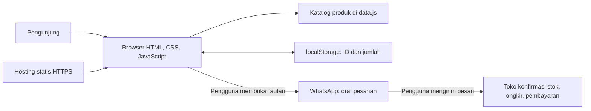

# Arsitektur — Maniak Aksesoris

## Bentuk sistem
Aplikasi katalog statis satu halaman. Katalog, pencarian, filter, jumlah, dan total diproses di browser.



## Modul runtime
```text
index.html
css/styles.css
js/config.js       # Identitas toko dan nomor WhatsApp
js/data.js         # Katalog dan harga
js/app.js          # Render, pencarian, filter, formulir
js/cart.js         # Keranjang dan perhitungan
js/storage.js      # Persistensi dan sanitasi state
js/checkout.js     # Validasi dan draf WhatsApp
assets/images/     # Ilustrasi SVG lokal
```

Kunci penyimpanan `rona-studio:cart:v1` hanya berisi versi skema, ID produk, dan jumlah. Harga berasal dari katalog; kontak dan total tidak disimpan.

## Kepercayaan dan batas
Data storage divalidasi sebelum dipakai; input dinamis dirender melalui DOM API. Tautan WhatsApp dibentuk dengan `encodeURIComponent` dan hanya dibuka setelah tindakan pengguna. Situs tidak mengonfirmasi stok, pembayaran, atau pesanan berhasil.

Deployment hanya aset statis melalui HTTPS; tanpa build, backend, database, atau rahasia frontend.
